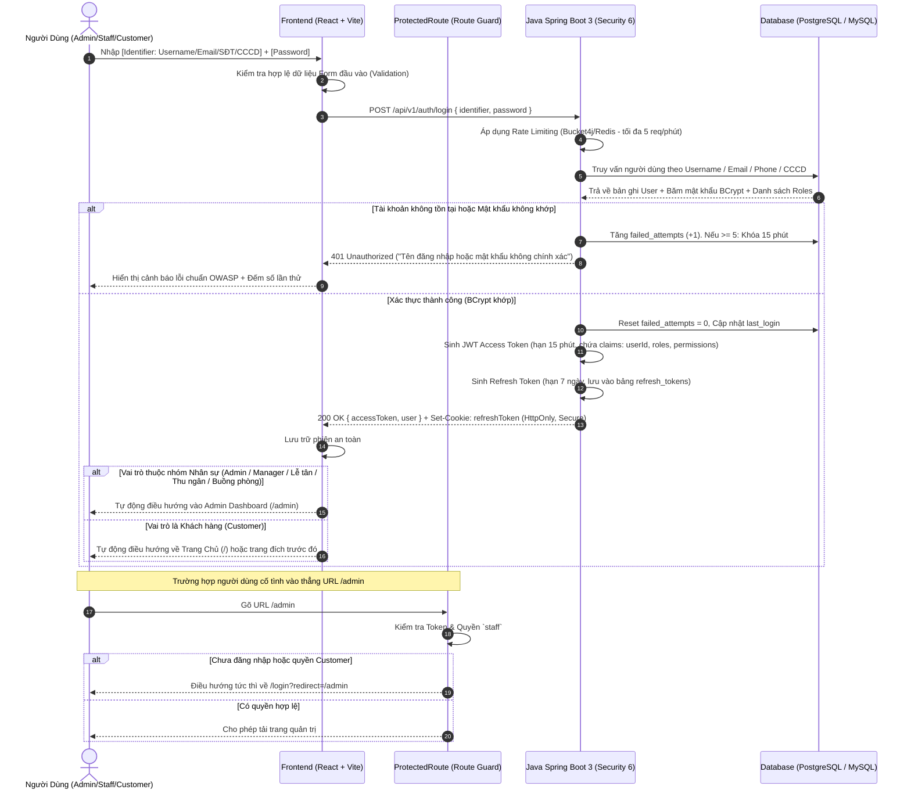
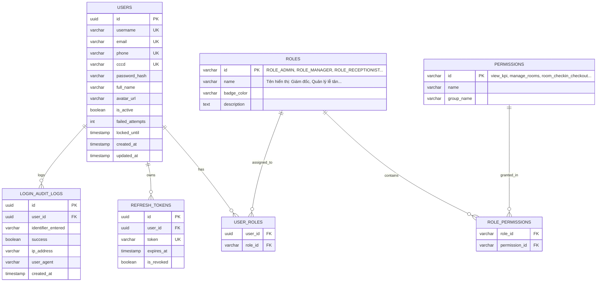

# TÀI LIỆU THIẾT KẾ & KẾ HOẠCH NÂNG CẤP HỆ THỐNG XÁC THỰC (AUTHENTICATION & RBAC)
## Dự án: Grand Hotel & Resorts Management System (eProject)
**File:** `login.md`  
**Ngày cập nhật:** 21/10/2026  
**Trạng thái:** Đã hoàn thiện Frontend & Thiết kế chuẩn Backend Java Spring Boot 3

---

## MỤC LỤC
1. [Tổng Quan & Đặt Vấn Đề](#1-tổng-quan--đặt-vấn-đề)
2. [Các Lỗ Hổng Bảo Mật Đã Khắc Phục](#2-các-lỗ-hổng-bảo-mật-đã-khắc-phục)
3. [Kiến Trúc & Quy Trình Nghiệp Vụ Chuẩn (Business Flow)](#3-kiến-trúc--quy-trình-nghiệp-vụ-chuẩn-business-flow)
4. [Kế Hoạch Xây Dựng Backend Java (Spring Boot 3 + Security 6 + JWT)](#4-kế-hoạch-xây-dựng-backend-java-spring-boot-3--security-6--jwt)
   - [4.1. Tech Stack Khuyến Nghị](#41-tech-stack-khuyến-nghị)
   - [4.2. Thiết Kế Cơ Sở Dữ Liệu (ERD & DDL)](#42-thiết-kế-cơ-sở-dữ-liệu-erd--ddl)
   - [4.3. Danh Sách RESTful API Endpoints](#43-danh-sách-restful-api-endpoints)
   - [4.4. Mã Nguồn Mẫu Backend Java Chuẩn Nghiệp Vụ](#44-mã-nguồn-mẫu-backend-java-chuẩn-nghiệp-vụ)
5. [Cấu Trúc Triển Khai Frontend (React + Vite)](#5-cấu-trúc-triển-khai-frontend-react--vite)
   - [5.1. Màn Hình Đăng Nhập Đẳng Cấp 5 Sao (`Login.jsx` & `Login.css`)](#51-màn-hình-đăng-nhập-đẳng-cấp-5-sao-loginjsx--logincss)
   - [5.2. Lớp Bảo Vệ Tuyến Đường (`ProtectedRoute.jsx`)](#52-lớp-bảo-vệ-tuyến-đường-protectedroutejsx)
   - [5.3. Cơ Chế Chống Brute-Force & Rate Limiting](#53-cơ-chế-chống-brute-force--rate-limiting)
6. [Danh Mục Tài Khoản Thử Nghiệm Nghiệp Vụ (Testing Guide)](#6-danh-mục-tài-khoản-thử-nghiệm-nghiệp-vụ-testing-guide)

---

## 1. Tổng Quan & Đặt Vấn Đề

Trong hệ thống Quản lý Khách sạn 5 sao (Hotel Management System / PMS), phân hệ **Xác thực (Authentication)** và **Kiểm soát truy cập dựa trên vai trò (Role-Based Access Control - RBAC)** đóng vai trò sống còn:
- **Khách hàng (Customer):** Cần trải nghiệm đăng nhập liền mạch qua Tên đăng nhập, Email, Số điện thoại hoặc số Căn cước công dân (CCCD), tự động liên kết với lịch sử đặt phòng và hồ sơ định danh cá nhân.
- **Nhân viên & Quản trị viên (Staff & Management):** Được phân quyền nghiêm ngặt theo chức vụ nội bộ (Tổng giám đốc, Quản lý lễ tân, Nhân viên lễ tân, Kế toán/Thu ngân, Quản lý buồng phòng).
- Hệ thống phải đảm bảo tuân thủ tiêu chuẩn bảo mật **OWASP Top 10**, ngăn chặn hoàn toàn việc rò rỉ quyền quản trị, chống tấn công brute-force và loại bỏ mọi nút bấm bypass đăng nhập trái phép.

---

## 2. Các Lỗ Hổng Bảo Mật Đã Khắc Phục

| Thành phần cũ | Lỗ hổng / Bất cập | Giải pháp đã khắc phục ngay |
| :--- | :--- | :--- |
| **Nút "Vào Nhanh" (Quick Login)** | Có 2 nút bấm *"Vào Nhanh: Quản Trị Viên (admin / 123456)"* và *"Vào Nhanh: Khách Hàng VIP"*. Bấm nút là vào thẳng Admin Dashboard mà không cần nhập mật khẩu. | **Xóa bỏ hoàn toàn**. Bắt buộc mọi truy cập phải qua form xác thực có kiểm tra mật khẩu. |
| **Hộp tài khoản ghim sẵn** | Khung viền vàng nổi bật ghim cứng `admin / 123456` giữa trang đăng nhập công khai. | **Loại bỏ**. Thay bằng Modal danh mục tài khoản thử nghiệm kín đáo phục vụ riêng cho tester/giám khảo. |
| **Dropdown chọn quyền** | Thẻ `<select>` cho phép người dùng tự chọn là "Nhân viên" hay "Khách hàng" khi submit. | **Loại bỏ hoàn toàn**. Hệ thống tự động xác định vai trò dựa trên tài khoản trong cơ sở dữ liệu sau khi giải mã mật khẩu. |
| **Nút "Quản Trị" trên Landing** | Hiển thị nút *"Quản Trị"* màu vàng trên Header [`Landing.jsx`](file:///Users/alanstars1301/Documents/Hotel%20Management/hotel-fe/src/pages/Landing.jsx) cho cả khách chưa đăng nhập và khách hàng thường. | **Gỡ bỏ khỏi giao diện khách**. Chỉ hiển thị nút *"Vào Admin Dashboard"* khi phiên đăng nhập đã xác thực là `staff`. Bổ sung link *"Cổng Nội Bộ"* kín đáo dưới Footer. |
| **Bảo vệ URL trực tiếp** | Người dùng gõ trực tiếp URL `/admin` trên thanh địa chỉ trình duyệt vẫn vào được trang quản trị mà không bị chặn. | **Bổ sung [`ProtectedRoute.jsx`](file:///Users/alanstars1301/Documents/Hotel%20Management/hotel-fe/src/components/ProtectedRoute.jsx)** bọc route `/admin`, tự động redirect về `/login?redirect=/admin` nếu chưa đăng nhập hoặc không đủ quyền. |

---

## 3. Kiến Trúc & Quy Trình Nghiệp Vụ Chuẩn (Business Flow)



---

## 4. Kế Hoạch Xây Dựng Backend Java (Spring Boot 3 + Security 6 + JWT)

### 4.1. Tech Stack Khuyến Nghị
- **Ngôn ngữ:** Java 17 hoặc Java 21 LTS.
- **Framework:** Spring Boot 3.3.x.
- **Bảo mật:** Spring Security 6.x + `io.jsonwebtoken:jjwt-api:0.12.5`.
- **Cơ sở dữ liệu:** PostgreSQL 16 hoặc MySQL 8.
- **Truy cập dữ liệu:** Spring Data JPA (Hibernate 6) + HikariCP Connection Pool.
- **Kiểm tra dữ liệu (Validation):** Hibernate Validator / Jakarta Validation.
- **Xử lý bất đối xứng & Cache:** Spring Cache + Redis (lưu Token Blacklist và Rate Limit Bucket).

---

### 4.2. Thiết Kế Cơ Sở Dữ Liệu (ERD & DDL)



#### Mã DDL SQL Khởi Tạo (PostgreSQL):
```sql
-- 1. Bảng Người Dùng (Users)
CREATE TABLE users (
    id UUID PRIMARY KEY DEFAULT gen_random_uuid(),
    username VARCHAR(50) UNIQUE NOT NULL,
    email VARCHAR(100) UNIQUE,
    phone VARCHAR(20) UNIQUE,
    cccd VARCHAR(20) UNIQUE,
    password_hash VARCHAR(255) NOT NULL,
    full_name VARCHAR(100) NOT NULL,
    avatar_url VARCHAR(255),
    is_active BOOLEAN DEFAULT TRUE,
    failed_attempts INT DEFAULT 0,
    locked_until TIMESTAMP,
    created_at TIMESTAMP DEFAULT CURRENT_TIMESTAMP,
    updated_at TIMESTAMP DEFAULT CURRENT_TIMESTAMP
);

-- 2. Bảng Vai Trò (Roles)
CREATE TABLE roles (
    id VARCHAR(50) PRIMARY KEY, -- ROLE_ADMIN, ROLE_MANAGER, ROLE_RECEPTIONIST, ROLE_CASHIER, ROLE_HOUSEKEEPING, ROLE_CUSTOMER
    name VARCHAR(100) NOT NULL,
    badge_color VARCHAR(20),
    description TEXT
);

-- 3. Bảng Quyền Hạn (Permissions)
CREATE TABLE permissions (
    id VARCHAR(50) PRIMARY KEY, -- view_kpi, view_revenue, manage_rooms, room_checkin_checkout...
    name VARCHAR(100) NOT NULL,
    group_name VARCHAR(100) NOT NULL
);

-- 4. Bảng Liên Kết User - Role
CREATE TABLE user_roles (
    user_id UUID REFERENCES users(id) ON DELETE CASCADE,
    role_id VARCHAR(50) REFERENCES roles(id) ON DELETE CASCADE,
    PRIMARY KEY (user_id, role_id)
);

-- 5. Bảng Liên Kết Role - Permission
CREATE TABLE role_permissions (
    role_id VARCHAR(50) REFERENCES roles(id) ON DELETE CASCADE,
    permission_id VARCHAR(50) REFERENCES permissions(id) ON DELETE CASCADE,
    PRIMARY KEY (role_id, permission_id)
);

-- 6. Bảng Refresh Token
CREATE TABLE refresh_tokens (
    id UUID PRIMARY KEY DEFAULT gen_random_uuid(),
    user_id UUID REFERENCES users(id) ON DELETE CASCADE,
    token VARCHAR(500) UNIQUE NOT NULL,
    expires_at TIMESTAMP NOT NULL,
    is_revoked BOOLEAN DEFAULT FALSE,
    created_at TIMESTAMP DEFAULT CURRENT_TIMESTAMP
);

-- 7. Bảng Nhật Ký Đăng Nhập (Audit Log)
CREATE TABLE login_audit_logs (
    id UUID PRIMARY KEY DEFAULT gen_random_uuid(),
    user_id UUID REFERENCES users(id) ON DELETE SET NULL,
    identifier_entered VARCHAR(100),
    success BOOLEAN NOT NULL,
    ip_address VARCHAR(45),
    user_agent TEXT,
    created_at TIMESTAMP DEFAULT CURRENT_TIMESTAMP
);
```

---

### 4.3. Danh Sách RESTful API Endpoints

| Method | Endpoint | Quyền hạn | Mô tả |
| :--- | :--- | :--- | :--- |
| `POST` | `/api/v1/auth/login` | Công khai | Nhận `{ identifier, password }`, xác thực, trả về Access Token + Refresh Token Cookie. |
| `POST` | `/api/v1/auth/register` | Công khai | Đăng ký thành viên mới kèm mã OTP. |
| `POST` | `/api/v1/auth/refresh-token` | Công khai (cần Cookie) | Cấp lại Access Token mới khi token cũ hết hạn (Silent Refresh). |
| `POST` | `/api/v1/auth/logout` | Đã xác thực | Thu hồi Refresh Token, xóa Cookie, đưa Access Token vào Blacklist. |
| `GET` | `/api/v1/auth/me` | Đã xác thực | Trả về thông tin cá nhân, danh sách vai trò và quyền hạn của token hiện hành. |

#### Cấu Trúc Request / Response Đăng Nhập:
**Request:**
```json
POST /api/v1/auth/login
Content-Type: application/json

{
  "identifier": "admin",
  "password": "your_secure_password"
}
```

**Response Thành Công (HTTP 200):**
```json
{
  "success": true,
  "message": "Đăng nhập thành công vào hệ thống Grand Hotel",
  "data": {
    "tokenType": "Bearer",
    "accessToken": "eyJhbGciOiJIUzI1NiIsInR5cCI6IkpXVCJ9...",
    "expiresIn": 900,
    "user": {
      "id": "c1f7a0b3-8d6b-4e12-b2f7-6b45e2a39d01",
      "username": "admin",
      "fullName": "Hoàng Minh Quân",
      "email": "quan.hoang@grandhotel.vn",
      "roles": ["ROLE_ADMIN"],
      "permissions": [
        "view_kpi", "view_revenue", "manage_rooms",
        "room_checkin_checkout", "room_cleaning",
        "manage_bookings", "create_booking", "cancel_booking",
        "manage_finances", "view_staff", "manage_staff",
        "config_permissions", "system_reset"
      ]
    }
  }
}
```

**Response Thất Bại (HTTP 401):**
```json
{
  "success": false,
  "errorCode": "AUTH_INVALID_CREDENTIALS",
  "message": "Thông tin đăng nhập hoặc mật khẩu không chính xác.",
  "timestamp": "2026-10-21T15:50:00Z"
}
```

---

### 4.4. Mã Nguồn Mẫu Backend Java Chuẩn Nghiệp Vụ

#### 1. DTO `LoginRequest.java`:
```java
package vn.grandhotel.dto.request;

import jakarta.validation.constraints.NotBlank;
import lombok.Getter;
import lombok.Setter;

@Getter
@Setter
public class LoginRequest {
    @NotBlank(message = "Tên đăng nhập, email hoặc CCCD không được để trống")
    private String identifier;

    @NotBlank(message = "Mật khẩu không được để trống")
    private String password;
}
```

#### 2. DTO `AuthResponse.java`:
```java
package vn.grandhotel.dto.response;

import lombok.Builder;
import lombok.Getter;
import java.util.List;

@Getter
@Builder
public class AuthResponse {
    private String tokenType;
    private String accessToken;
    private long expiresIn;
    private UserSummary user;

    @Getter
    @Builder
    public static class UserSummary {
        private String id;
        private String username;
        private String fullName;
        private String email;
        private List<String> roles;
        private List<String> permissions;
    }
}
```

#### 3. Service Xử Lý JWT `JwtService.java`:
```java
package vn.grandhotel.security;

import io.jsonwebtoken.Claims;
import io.jsonwebtoken.Jwts;
import io.jsonwebtoken.security.Keys;
import org.springframework.beans.factory.annotation.Value;
import org.springframework.stereotype.Service;

import javax.crypto.SecretKey;
import java.nio.charset.StandardCharsets;
import java.util.Date;
import java.util.List;
import java.util.Map;

@Service
public class JwtService {

    @Value("${application.security.jwt.secret-key}")
    private String secretKey;

    @Value("${application.security.jwt.access-token-expiration-ms:900000}") // 15 phút
    private long accessTokenExpiration;

    private SecretKey getSigningKey() {
        return Keys.hmacShaKeyFor(secretKey.getBytes(StandardCharsets.UTF_8));
    }

    public String generateAccessToken(String username, String userId, List<String> roles, List<String> permissions) {
        return Jwts.builder()
                .subject(username)
                .claim("userId", userId)
                .claim("roles", roles)
                .claim("permissions", permissions)
                .issuedAt(new Date(System.currentTimeMillis()))
                .expiration(new Date(System.currentTimeMillis() + accessTokenExpiration))
                .signWith(getSigningKey())
                .compact();
    }

    public Claims extractAllClaims(String token) {
        return Jwts.parser()
                .verifyWith(getSigningKey())
                .build()
                .parseSignedClaims(token)
                .getPayload();
    }

    public boolean isTokenValid(String token, String username) {
        final Claims claims = extractAllClaims(token);
        return claims.getSubject().equals(username) && !claims.getExpiration().before(new Date());
    }
}
```

#### 4. Cấu Hình Bảo Mật Spring Security 6 `SecurityConfig.java`:
```java
package vn.grandhotel.config;

import lombok.RequiredArgsConstructor;
import org.springframework.context.annotation.Bean;
import org.springframework.context.annotation.Configuration;
import org.springframework.security.authentication.AuthenticationManager;
import org.springframework.security.config.annotation.authentication.configuration.AuthenticationConfiguration;
import org.springframework.security.config.annotation.method.configuration.EnableMethodSecurity;
import org.springframework.security.config.annotation.web.builders.HttpSecurity;
import org.springframework.security.config.annotation.web.configuration.EnableWebSecurity;
import org.springframework.security.config.http.SessionCreationPolicy;
import org.springframework.security.crypto.bcrypt.BCryptPasswordEncoder;
import org.springframework.security.crypto.password.PasswordEncoder;
import org.springframework.security.web.SecurityFilterChain;
import org.springframework.security.web.authentication.UsernamePasswordAuthenticationFilter;
import vn.grandhotel.security.JwtAuthenticationFilter;

@Configuration
@EnableWebSecurity
@EnableMethodSecurity
@RequiredArgsConstructor
public class SecurityConfig {

    private final JwtAuthenticationFilter jwtAuthFilter;

    @Bean
    public SecurityFilterChain securityFilterChain(HttpSecurity http) throws Exception {
        http
            .csrf(csrf -> csrf.disable())
            .sessionManagement(session -> session.sessionCreationPolicy(SessionCreationPolicy.STATELESS))
            .authorizeHttpRequests(auth -> auth
                .requestMatchers(
                    "/api/v1/auth/login",
                    "/api/v1/auth/register",
                    "/api/v1/auth/refresh-token",
                    "/api/v1/public/**",
                    "/swagger-ui/**",
                    "/v3/api-docs/**"
                ).permitAll()
                .requestMatchers("/api/v1/admin/**").hasAnyRole("ADMIN", "MANAGER", "RECEPTIONIST", "CASHIER", "HOUSEKEEPING")
                .anyRequest().authenticated()
            )
            .addFilterBefore(jwtAuthFilter, UsernamePasswordAuthenticationFilter.class);

        return http.build();
    }

    @Bean
    public PasswordEncoder passwordEncoder() {
        return new BCryptPasswordEncoder(12); // BCrypt độ dài muối 12
    }

    @Bean
    public AuthenticationManager authenticationManager(AuthenticationConfiguration config) throws Exception {
        return config.getAuthenticationManager();
    }
}
```

---

## 5. Cấu Trúc Triển Khai Frontend (React + Vite)

Hệ thống Frontend đã được xây dựng và cập nhật trực tiếp tại thư mục `hotel-fe/src/`.

### 5.1. Màn Hình Đăng Nhập Đẳng Cấp 5 Sao ([`Login.jsx`](file:///Users/alanstars1301/Documents/Hotel%20Management/hotel-fe/src/pages/Login.jsx) & [`Login.css`](file:///Users/alanstars1301/Documents/Hotel%20Management/hotel-fe/src/pages/Login.css))
- **Giao diện Luxury Glassmorphism:** Tone màu xanh đậm (`#0a0f1d`), hiệu ứng viền vàng kim (`#d4af37`), phông chữ cổ điển sang trọng *Cinzel* kết hợp *Plus Jakarta Sans*.
- **Form đăng nhập 1 ô thông minh:** Chấp nhận Tên đăng nhập, Email, Số điện thoại hoặc số CCCD.
- **Nút bật/tắt mắt mật khẩu:** Cho phép kiểm tra ký tự khi gõ.
- **Tự động nhận diện vai trò (Smart Routing):**
  - Tài khoản nhân viên $\rightarrow$ Tự động cấp phiên `staff`, ghi nhớ `ACTIVE_STAFF_ID`, chuyển hướng đến `/admin`.
  - Tài khoản khách hàng $\rightarrow$ Tự động cấp phiên `customer`, chuyển hướng về trang chủ `/`.
- **Cơ chế chống Brute-Force:** Ghi nhận số lần thử sai. Khi nhập sai 5 lần liên tiếp, nút đăng nhập sẽ bị vô hiệu hóa trong 30 giây kèm bộ đếm ngược thời gian thực.
- **Modal tài khoản kiểm thử nghiệp vụ:** Một nút kín đáo *"Bảng Danh Mục Tài Khoản Thử Nghiệm"* giúp người đánh giá/tester xem danh sách tài khoản mẫu và bấm *"Điền vào Form"*, sau đó người dùng vẫn phải bấm *"Đăng Nhập"* để hệ thống thực thi xác thực thực tế.

---

### 5.2. Lớp Bảo Vệ Tuyến Đường ([`ProtectedRoute.jsx`](file:///Users/alanstars1301/Documents/Hotel%20Management/hotel-fe/src/components/ProtectedRoute.jsx))

```jsx
import { Navigate, useLocation } from 'react-router-dom';

const STORAGE_KEYS = {
  USER: 'grand_hotel_current_user_v2',
};

export default function ProtectedRoute({ children, requiredRole }) {
  const location = useLocation();
  const savedUser = localStorage.getItem(STORAGE_KEYS.USER);
  const currentUser = savedUser ? JSON.parse(savedUser) : null;

  // 1. Chưa đăng nhập -> Điều hướng về /login kèm redirect query
  if (!currentUser) {
    return <Navigate to={`/login?redirect=${encodeURIComponent(location.pathname)}`} replace state={{ from: location }} />;
  }

  // 2. Không đủ quyền hạn (vd: khách hàng cố vào trang /admin) -> Chặn và đẩy về trang chủ
  if (requiredRole && currentUser.role !== requiredRole) {
    return <Navigate to="/" replace />;
  }

  return children;
}
```

Tích hợp trong [`App.jsx`](file:///Users/alanstars1301/Documents/Hotel%20Management/hotel-fe/src/App.jsx):
```jsx
<Route 
  path="/admin" 
  element={
    <ProtectedRoute requiredRole="staff">
      <AdminDashboard />
    </ProtectedRoute>
  } 
/>
<Route 
  path="/profile" 
  element={
    <ProtectedRoute>
      <Profile />
    </ProtectedRoute>
  } 
/>
```

---

## 6. Danh Mục Tài Khoản Thử Nghiệm Nghiệp Vụ (Testing Guide)

Toàn bộ các tài khoản dưới đây đã được lập trình sẵn trong hệ thống phục vụ công tác kiểm thử (Mật khẩu mặc định: `123456`):

| STT | Họ Và Tên | Tên Đăng Nhập / Email | Vai Trò (Role) | Chức Năng Thử Nghiệm Chính |
| :---: | :--- | :--- | :---: | :--- |
| **1** | Hoàng Minh Quân | `admin`<br>`quan.hoang@grandhotel.vn` | **Giám Đốc / Admin** | Toàn quyền hệ thống: Báo cáo tài chính 3 năm, quản lý danh mục phòng, sổ quỹ, cấu hình ma trận phân quyền, reset hệ thống. |
| **2** | Nguyễn Thu Thảo | `manager`<br>`thao.nguyen@grandhotel.vn` | **Quản Lý Lễ Tân** | Giám sát sơ đồ phòng, xem danh sách đơn đặt cọc, quản lý trạng thái dọn dẹp buồng phòng, xem sổ quỹ tiền tệ. |
| **3** | Lê Hoàng Nam | `receptionist`<br>`nam.le@grandhotel.vn` | **Nhân Viên Lễ Tân** | Thao tác Check-in (giao chìa khóa), Check-out (tính bill minibar & quyết toán), tạo đơn khách vãng lai (walk-in). |
| **4** | Phạm Đăng Khoa | `cashier`<br>`khoa.pham@grandhotel.vn` | **Kế Toán / Thu Ngân** | Theo dõi dòng tiền doanh thu 3 năm, đối soát giao dịch đặt cọc VietQR và tiền mặt, xuất báo cáo tài chính Excel. |
| **5** | Trần Thị Lan | `housekeeping`<br>`lan.tran@grandhotel.vn` | **Quản Lý Buồng Phòng** | Chỉ hiển thị và thao tác chuyển đổi trạng thái dọn dẹp các phòng từ "Đang dọn" sang "Trống (Sẵn sàng đón khách)". |
| **6** | Nguyễn Văn An | `khachhang`<br>`an.nguyen@email.com`<br>`0901234567` | **Khách Hàng (Customer)** | Đặt phòng trực tuyến, thanh toán cọc VietQR, xem lịch sử đơn đặt cá nhân, cập nhật hồ sơ định danh CCCD. |

---

### Hướng Dẫn Thao Tác Thử Nghiệm:
1. Mở trình duyệt truy cập: **[http://localhost:5173/login](http://localhost:5173/login)**.
2. Thử nhập sai mật khẩu $\rightarrow$ Quan sát hệ thống báo lỗi chuẩn và đếm số lần nhập sai. Nhập sai 5 lần $\rightarrow$ Xem cơ chế khóa tạm thời 30 giây.
3. Bấm nút **"Bảng Danh Mục Tài Khoản Thử Nghiệm"** $\rightarrow$ Chọn vai trò cần test và bấm **"Điền vào Form"** $\rightarrow$ Bấm **"Đăng Nhập Vào Hệ Thống"**.
4. Kiểm tra khả năng tự chuyển hướng:
   - Với tài khoản Nhân sự: Tự chuyển thẳng đến Dashboard quản trị.
   - Với tài khoản Khách hàng: Tự chuyển về Cổng đặt phòng & Hồ sơ cá nhân.
5. Thử đăng xuất và gõ trực tiếp `http://localhost:5173/admin` để xác thực cơ chế Route Guard hoạt động bảo vệ trang.
